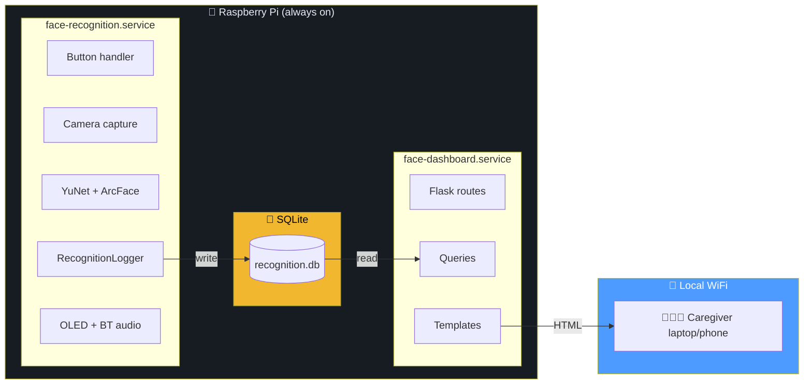

# 📘 Cognitive Assist — Operations Manual

> Everything you need to run, troubleshoot, and maintain the system.
> If `README.md` gets you started, `MANUAL.md` keeps you running.

**Table of contents**

1. [System architecture](#1-system-architecture)
2. [Component reference](#2-component-reference)
3. [Database schema](#3-database-schema)
4. [Service management](#4-service-management)
5. [Log viewing](#5-log-viewing)
6. [Backup and restore](#6-backup-and-restore)
7. [Database inspection](#7-database-inspection)
8. [Adding a new person](#8-adding-a-new-person)
9. [Reviewing unknown faces](#9-reviewing-unknown-faces)
10. [Exporting data](#10-exporting-data)
11. [Accessing the dashboard](#11-accessing-the-dashboard)
12. [Troubleshooting](#12-troubleshooting)
13. [Security](#13-security)
14. [Maintenance schedule](#14-maintenance-schedule)
15. [FAQ](#15-faq)

---

## 1. System architecture

### 1.1 Two services, one database




**Key guarantees:**

| **Property**                             | **Why it matters**                     |
| :--------------------------------------- | :------------------------------------- |
| The services share only the SQLite file  | Stopping one never stops the other     |
| Dashboard never opens the camera         | No CPU contention                      |
| Dashboard never loads a model            | Saves \~50–80 MB RAM                   |
| WAL mode + busy_timeout                  | Logger can write while dashboard reads |
| Dashboard is read-only except one UPDATE | Cannot corrupt recognition data        |

### 1.2 Button press sequence

```
sequenceDiagram
    participant U as 👆 User
    participant G as GPIO
    participant FR as face_recognition
    participant CAM as Camera
    participant M as Models
    participant LOG as Logger
    participant DB as SQLite
    participant UI as OLED/Audio
    
    U->>G: press button
    G->>FR: scan_requested event
    FR->>UI: "SCANNING"
    FR->>CAM: capture 1s burst
    CAM-->>FR: best frame + landmarks
    alt no face detected
        FR->>LOG: log_no_face()
        LOG->>DB: INSERT NO_FACE
        FR->>UI: "No face detected"
    else face detected
        FR->>M: YuNet → landmarks
        FR->>M: ArcFace → 512-d embedding
        M-->>FR: embedding vector
        FR->>FR: compare vs 470 registered
        alt similarity ≥ 0.40
            FR->>LOG: log_known(name, score)
            LOG->>DB: INSERT KNOWN
            FR->>UI: "Alice detected"
        else similarity < 0.40
            FR->>LOG: log_unknown(score, crop, embedding)
            LOG->>DB: INSERT UNKNOWN
            LOG->>LOG: save crop.jpg + emb.npy
            FR->>UI: "I do not recognise this person"
        end
    end
    FR->>UI: "READY - PRESS BTN"
    Note over U,UI: 5-second cooldown before next press accepted
```


### 1.3 Dashboard request flow

```
sequenceDiagram
    participant B as 🌐 Browser
    participant F as Flask
    participant Q as queries.py
    participant DB as SQLite
    
    B->>F: GET /
    F->>Q: get_summary_stats()
    Q->>DB: SELECT status, COUNT(*) GROUP BY status
    DB-->>Q: rows
    Q-->>F: {known: N, unknown: M, ...}
    F->>Q: get_recent_events(limit=10)
    Q->>DB: SELECT ... LIMIT 10
    DB-->>Q: rows
    Q-->>F: list
    F->>F: render dashboard.html
    F-->>B: HTML (200)
    
    B->>F: GET /unknown/42/image
    F->>Q: get_event_by_id(42)
    Q->>DB: SELECT * WHERE id=42
    DB-->>Q: row
    Q-->>F: {image_path: "logs/..."}
    F->>F: validate path inside UNKNOWN_FACES_DIR
    F-->>B: send_file(image.jpg) or 404
```


---

## 2. Component reference

### 2.1 Every file, what it does

| **File**                   | **Type**      | **Purpose**                                                |
| :------------------------- | :------------ | :--------------------------------------------------------- |
| `face_recognition.py`      | Service entry | Main loop, GPIO, integration                               |
| `config.py`                | Config        | All paths, GPIO pins, thresholds                           |
| `face_camera.py`           | Helper        | `open_camera()`, `capture_best_face()`, `create_arcface()` |
| `face_database.py`         | Helper        | Load `.npy` + `.csv`, cosine similarity matching           |
| `button_handler.py`        | Helper        | GPIO debounce + cooldown + `lgpio` callback                |
| `bluetooth_audio.py`       | Helper        | Piper TTS + `paplay` to BT sink                            |
| `oled_display.py`          | Helper        | SH1106 rendering                                           |
| `recognition_logger.py`    | **NEW**       | Writes events to SQLite, saves crops + embeddings          |
| `database_setup.py`        | **NEW**       | Creates schema, syncs people table                         |
| `web_dashboard/app.py`     | **NEW**       | Flask app + all routes                                     |
| `web_dashboard/queries.py` | **NEW**       | All SQL queries (read-only + one UPDATE)                   |
| `web_dashboard/config.py`  | **NEW**       | Self-contained paths (no `cv2` import)                     |
| `web_dashboard/templates/` | **NEW**       | 8 HTML templates (Jinja2)                                  |
| `web_dashboard/static/`    | **NEW**       | CSS + minimal JS                                           |
| `run_dashboard.sh`         | **NEW**       | Foreground dashboard runner                                |
| `backup_database.sh`       | **NEW**       | Safe SQLite `.backup`                                      |
| `show_dashboard_url.sh`    | **NEW**       | Prints reachable URLs                                      |
| `face-dashboard.service`   | **NEW**       | systemd unit                                               |
| `tests/*.py`               | **NEW**       | 5 test modules, all pure-Python                            |

### 2.2 Key constants in `config.py`


```
THRESHOLD = 0.40              # cosine similarity → KNOWN
YUNET_SCORE_THRESHOLD = 0.60  # face detection confidence
CAPTURE_SECONDS = 1.0         # how long to sample frames per press
MIN_FACE_SIZE = 40            # reject tiny faces (pixels)
BUTTON_COOLDOWN_SECONDS = 5.0 # ignore repeats for 5s
CAMERA_WIDTH = 320            # capture resolution
CAMERA_HEIGHT = 240
ORT_INTRA_OP_THREADS = 2      # ONNX CPU threads
DASHBOARD_PORT = 5000
```


Editing any of these requires restarting the relevant service:


```
sudo systemctl restart face-recognition   # for threshold, camera, GPIO
sudo systemctl restart face-dashboard     # for dashboard port
```


---

## 3. Database schema

### 3.1 The two tables

```
erDiagram
    recognition_events ||--o{ people : "person_id (nullable)"
    
    recognition_events {
        INTEGER id PK
        TEXT timestamp "ISO-8601 UTC"
        TEXT created_at "ISO-8601 UTC"
        INTEGER person_id FK "nullable"
        TEXT person_name "raw label from metadata.csv"
        TEXT status "KNOWN | UNKNOWN | NO_FACE | ERROR"
        REAL similarity_score "nullable"
        TEXT image_path "relative to project root"
        TEXT embedding_path "relative to project root"
        TEXT review_status "PENDING | CONFIRMED | DISMISSED"
        TEXT error_message "nullable"
    }
    
    people {
        INTEGER id PK
        TEXT name "unique, matches metadata.csv"
        TEXT created_at
    }
```


### 3.2 What each status means

| **Status**  | `person_name`    | `similarity_score` | `image_path` | `review_status`            |
| :---------- | :--------------- | :----------------- | :----------- | :------------------------- |
| **KNOWN**   | the matched name | best similarity    | NULL         | NULL                       |
| **UNKNOWN** | NULL             | best similarity    | saved crop   | `PENDING`                  |
| **NO_FACE** | NULL             | NULL               | NULL         | NULL                       |
| **ERROR**   | NULL             | NULL               | NULL         | NULL (`error_message` set) |

### 3.3 Indexes (for performance)


```
idx_events_timestamp     ← fast ORDER BY timestamp DESC (default dashboard view)
idx_events_status        ← fast WHERE status = 'UNKNOWN'
idx_events_person_id     ← fast JOIN on people
idx_events_review_status ← fast WHERE review_status = 'PENDING' (partial index)
```


### 3.4 WAL mode


```
PRAGMA journal_mode=WAL;
```


This is what allows logger and dashboard to work simultaneously. Two files appear next to `recognition.db`:

- `recognition.db-wal` — write-ahead log
- `recognition.db-shm` — shared memory

**Both must be kept if you manually copy the DB.** The backup script handles this correctly (uses `.backup` API, not `cp`).

---

## 4. Service management

### 4.1 The four `systemctl` commands you need

| **Command**                | **What it does**                                |
| :------------------------- | :---------------------------------------------- |
| `systemctl status <name>`  | Show current state (running / stopped / failed) |
| `systemctl start <name>`   | Start now                                       |
| `systemctl stop <name>`    | Stop now                                        |
| `systemctl restart <name>` | Stop + start                                    |
| `systemctl enable <name>`  | Auto-start on boot                              |
| `systemctl disable <name>` | Don't auto-start on boot                        |

### 4.2 Current state (yours)


```
systemctl is-active face-recognition   # active
systemctl is-active face-dashboard     # active
systemctl is-enabled face-recognition  # enabled
systemctl is-enabled face-dashboard    # enabled
```


### 4.3 Common scenarios

**Scenario: I want to stop the dashboard temporarily (keep recognition running).**


```
sudo systemctl stop face-dashboard
# recognition unaffected
sudo systemctl start face-dashboard   # when you want it back
```


**Scenario: I edited** `config.py`**, need to apply.**


```
sudo systemctl restart face-recognition
sudo systemctl restart face-dashboard
```


**Scenario: I edited a template or CSS file.**

Only the dashboard needs restart:


```
sudo systemctl restart face-dashboard
```


**Scenario: I edited** `face_recognition.py`**.**

Only recognition needs restart:


```
sudo systemctl restart face-recognition
```


**Scenario: something is broken, I want to see logs.**


```
sudo journalctl -u face-recognition -n 100 --no-pager
sudo journalctl -u face-dashboard -n 100 --no-pager
```


**Scenario: I want to see real-time logs.**


```
sudo journalctl -u face-recognition -f
# press Ctrl-C to stop following
```


### 4.4 Verify service files are correct


```
# Show effective service config (includes drop-ins):
sudo systemctl cat face-dashboard

# Show only environment variables:
sudo systemctl show face-dashboard -p Environment

# Test if unit file syntax is valid:
sudo systemd-analyze verify /etc/systemd/system/face-dashboard.service
```


### 4.5 If a service fails to start


```
# Step 1 — see why:
sudo systemctl status face-dashboard
sudo journalctl -u face-dashboard -n 30 --no-pager

# Step 2 — common causes:
#   - Wrong ExecStart= path (check venv exists)
#   - Python syntax error (test: python -c "import web_dashboard.app")
#   - Missing file (the log says "No such file")
#   - Port 5000 already used (kill conflicting process)

# Step 3 — try running manually to see the full traceback:
cd /home/pi/FaceRecognitionSystem2
source /home/pi/FaceRecognitionSystem/.venv/bin/activate
python -m web_dashboard.app
```


---

## 5. Log viewing

### 5.1 The three types of logs

| **Type**            | **Where** | **Command**                      |
| :------------------ | :-------- | :------------------------------- |
| Recognition service | journald  | `journalctl -u face-recognition` |
| Dashboard service   | journald  | `journalctl -u face-dashboard`   |
| Flask request log   | journald  | (included in dashboard log)      |

### 5.2 Useful `journalctl` filters


```
# Last 50 lines
sudo journalctl -u face-dashboard -n 50 --no-pager

# Since 10 minutes ago
sudo journalctl -u face-dashboard --since "10 minutes ago"

# Since a specific time
sudo journalctl -u face-dashboard --since "2026-10-26 14:00"

# Today only
sudo journalctl -u face-dashboard --since today

# Filter by keyword
sudo journalctl -u face-recognition | grep -i error

# Follow live
sudo journalctl -u face-recognition -f
```


### 5.3 What you'll see in recognition logs

| **Prefix**  | **Meaning**                              |
| :---------- | :--------------------------------------- |
| `[BUTTON]`  | Button press / cooldown / scan lifecycle |
| `[CAPTURE]` | Frame sampling during a scan             |
| `[RESULT]`  | Final decision (KNOWN/UNKNOWN/NO_FACE)   |
| `[TIMING]`  | How long the scan took                   |
| `[FACE]`    | Detector confidence                      |
| `[LOGGER]`  | Database write success / failure         |
| `[VOICE]`   | Text queued for speech                   |
| `[AUDIO]`   | Bluetooth / Piper status                 |
| `[OLED]`    | Display update success                   |
| `[FATAL]`   | Unrecoverable startup error              |
| `[STOP]`    | Clean shutdown                           |

### 5.4 What you'll see in dashboard logs

| **Line**                                     | **Meaning**                         |
| :------------------------------------------- | :---------------------------------- |
| `[DASHBOARD] Serving on http://0.0.0.0:5000` | Started successfully                |
| `[DASHBOARD] Database: ...`                  | Which DB file is being read         |
| `GET / 200`                                  | A page was served successfully      |
| `GET /static/... 304`                        | Cached asset — normal               |
| `GET /favicon.ico 404`                       | Browser looking for icon — harmless |
| `POST /unknown/N/review 302`                 | Review status was updated           |
| `POST /unknown/N/review 403`                 | CSRF token rejected                 |

---

## 6. Backup and restore

### 6.1 Daily backup (recommended)


```
cd /home/pi/FaceRecognitionSystem2
./backup_database.sh
```


Output:


```
Database backed up to: /home/pi/FaceRecognitionSystem2/backups/recognition_20261026_143500.db
```


The backup runs **while services are running** — safe, no need to stop anything.

### 6.2 Full backup (DB + images)


```
./backup_database.sh --with-files
```


Also creates `backups/unknown_files_20261026_143500.tar.gz`.

### 6.3 Restore a backup

**Warning:** this overwrites the current database. Stop recognition first.


```
# Step 1 — stop both services
sudo systemctl stop face-recognition
sudo systemctl stop face-dashboard

# Step 2 — restore (pick one)
cp backups/recognition_20261026_143500.db database/recognition.db

# If restoring files too:
tar -xzf backups/unknown_files_20261026_143500.tar.gz -C .

# Step 3 — restart
sudo systemctl start face-recognition
sudo systemctl start face-dashboard

# Step 4 — verify
curl -s http://127.0.0.1:5000/health
```


### 6.4 Copy backups off the Pi


```
# From your laptop:
scp pi@192.168.114.246:/home/pi/FaceRecognitionSystem2/backups/*.db ./
scp pi@192.168.114.246:/home/pi/FaceRecognitionSystem2/backups/*.tar.gz ./
```


### 6.5 Retention policy

Nothing is deleted automatically. Over time:

| **Data**           | **Size estimate** | **Growth**               |
| :----------------- | :---------------- | :----------------------- |
| Database rows      | \~200 bytes/event | \~4 MB per 20,000 events |
| Unknown-face crops | \~4 KB/crop       | \~4 MB per 1000 unknowns |
| Unknown embeddings | \~2 KB/file       | \~2 MB per 1000 unknowns |

Clean old data manually when needed:


```
# Delete DB rows older than 90 days:
sqlite3 database/recognition.db \
  "DELETE FROM recognition_events WHERE timestamp < datetime('now', '-90 days');"

# Delete crop files older than 90 days:
find logs/unknown_faces -type f -mtime +90 -delete

# Delete embedding files older than 90 days:
find unknown_embeddings -type f -mtime +90 -delete
```


---

## 7. Database inspection

### 7.1 Install the CLI (one-time)


```
sudo apt install -y sqlite3
```


The application doesn't need this — it's only for manual inspection.

### 7.2 Common queries

**Count by status:**


```
sqlite3 database/recognition.db \
  "SELECT status, COUNT(*) FROM recognition_events GROUP BY status;"
```


Output:


```
KNOWN|127
UNKNOWN|9
NO_FACE|42
ERROR|0
```


**Latest 10 events:**


```
sqlite3 -header -column database/recognition.db \
  "SELECT id, timestamp, status, person_name, similarity_score
   FROM recognition_events
   ORDER BY id DESC LIMIT 10;"
```


**Today's events only:**


```
sqlite3 -header -column database/recognition.db \
  "SELECT id, timestamp, status, person_name
   FROM recognition_events
   WHERE timestamp >= date('now')
   ORDER BY id DESC;"
```


**All pending unknowns:**


```
sqlite3 -header -column database/recognition.db \
  "SELECT id, timestamp, similarity_score, image_path
   FROM recognition_events
   WHERE status = 'UNKNOWN' AND review_status = 'PENDING'
   ORDER BY id DESC;"
```


**Top recognised people:**


```
sqlite3 -header -column database/recognition.db \
  "SELECT person_name, COUNT(*) AS count
   FROM recognition_events
   WHERE status = 'KNOWN'
   GROUP BY person_name
   ORDER BY count DESC;"
```


**Disk space used by database:**


```
du -h database/recognition.db*
ls -lh logs/unknown_faces/ | head
```


### 7.3 Table structure


```
# Show all tables
sqlite3 database/recognition.db ".tables"

# Show columns of recognition_events
sqlite3 database/recognition.db ".schema recognition_events"

# Show columns of people
sqlite3 database/recognition.db ".schema people"

# List all indexes
sqlite3 database/recognition.db ".indexes"
```


### 7.4 Manual fix — delete one bad row


```
# View it first:
sqlite3 database/recognition.db "SELECT * FROM recognition_events WHERE id = 42;"

# Then delete:
sqlite3 database/recognition.db "DELETE FROM recognition_events WHERE id = 42;"

# If it had an image file, delete it too:
ls -l logs/unknown_faces/unknown_00000042_*.jpg
rm logs/unknown_faces/unknown_00000042_*.jpg
rm unknown_embeddings/unknown_00000042.npy
```


---

## 8. Adding a new person

### 8.1 The four-step process

```
flowchart TD
    A[Capture 10-20 photos of the new person] --> B[Generate embeddings]
    B --> C[Append to embeddings_clean.npy]
    A --> D[Append rows to metadata_clean.csv]
    C --> E[Rebuild the .npy file]
    D --> E
    E --> F[python database_setup.py --resync-people]
    F --> G[sudo systemctl restart face-recognition]
    G --> H([✅ New person recognised])
    
    style H fill:#3fbf72,color:#fff
```


### 8.2 What you need

1. **10–20 photos** of the person — front-facing, good lighting, varied angles.
2. **The embedding generation script** — if you don't have one, use `insightface`:


```
# One-off script to add a new person
import cv2
import numpy as np
from insightface.app import FaceAnalysis

app = FaceAnalysis(name='buffalo_l', providers=['CPUExecutionProvider'])
app.prepare(ctx_id=-1)

embeddings = np.load("Embeddings/embeddings_clean.npy")
new_embeddings = []

for photo_path in ["photo1.jpg", "photo2.jpg", ...]:
    img = cv2.imread(photo_path)
    faces = app.get(img)
    if len(faces) == 1:
        new_embeddings.append(faces[0].normed_embedding)
    else:
        print(f"{photo_path}: expected 1 face, got {len(faces)}")

all_embeddings = np.vstack([embeddings, np.array(new_embeddings)])
np.save("Embeddings/embeddings_clean.npy", all_embeddings)

# Append rows to metadata_clean.csv (one row per embedding)
with open("Embeddings/metadata_clean.csv", "a") as f:
    for _ in new_embeddings:
        f.write(f"New_Person_Name,...\n")
```


3. **Then sync the people table:**


```
python database_setup.py --resync-people
sudo systemctl restart face-recognition
```


### 8.3 Verify it worked


```
# Check new person is in the mirror:
sqlite3 database/recognition.db "SELECT name FROM people WHERE name = 'New_Person_Name';"

# Test by pressing button in front of them
# Watch logs:
sudo journalctl -u face-recognition -f
```


---

## 9. Reviewing unknown faces

### 9.1 The workflow

```
flowchart LR
    A[Unknown face detected] --> B[Saved to /unknown page]
    B --> C[Caregiver opens dashboard]
    C --> D[Reviews the crop]
    D --> E{Who is this?}
    E -->|Recognised| F[Click 'Mark confirmed']
    E -->|Stranger| G[Click 'Dismiss']
    E -->|Not sure yet| H[Leave as Pending]
    F --> I[(review_status = CONFIRMED)]
    G --> I2[(review_status = DISMISSED)]
    H --> I3[(review_status = PENDING)]
    
    style F fill:#3fbf72,color:#fff
    style G fill:#6b7785,color:#fff
```


### 9.2 How to use it

1. Open `http://<pi-ip>:5000/unknown`
2. Click any thumbnail
3. On the detail page, click **Mark confirmed**, **Dismiss**, or **Reset to pending**
4. Your choice is saved immediately to the database

### 9.3 What "Confirmed" does NOT do

**Important:** marking an unknown as `CONFIRMED` **does not add them to the face database**. It only records that a human reviewed this event.

To actually make the system recognise this person next time, follow **Section 8** (Adding a new person).

This design is intentional — automatic enrolment from an unknown face is risky (bad photo, wrong person, etc.).

### 9.4 Filter by review status

On `/unknown`, use the filter dropdown:

- **All** — every unknown
- **PENDING** — not reviewed yet
- **CONFIRMED** — you recognised this face
- **DISMISSED** — you marked as irrelevant

---

## 10. Exporting data

### 10.1 CSV export from dashboard

Go to `/history` and click **Export CSV**. The export respects your current filters (search, status, date range).

The downloaded file opens correctly in Excel, LibreOffice, and Google Sheets (UTF-8 BOM included).

Columns in the CSV:


```
id, timestamp, status, person_name, similarity_score,
review_status, error_message
```


### 10.2 Export directly from SQLite

**Full table to CSV:**


```
sqlite3 -header -csv database/recognition.db \
  "SELECT * FROM recognition_events;" > events.csv
```


**Filtered export (last 30 days, KNOWN only):**


```
sqlite3 -header -csv database/recognition.db \
  "SELECT id, timestamp, person_name, similarity_score
   FROM recognition_events
   WHERE status = 'KNOWN'
     AND timestamp >= datetime('now', '-30 days');" > known_recent.csv
```


---

## 11. Accessing the dashboard

### 11.1 Three access methods compared

| **Method**    | **URL**                       | **Works when**           | **Best for**    |
| :------------ | :---------------------------- | :----------------------- | :-------------- |
| **Direct IP** | `http://192.168.114.246:5000` | Same WiFi, IP unchanged  | Testing         |
| **mDNS**      | `http://project17.local:5000` | Same WiFi, avahi running | Home networks   |
| **Hotspot**   | `http://10.42.0.1:5000`       | Pi broadcasts WiFi       | Portable device |

### 11.2 Find the current URL


```
./show_dashboard_url.sh
```


Example output:


```
Dashboard URL candidates (port 5000):

  http://192.168.114.246:5000
  http://project17.local:5000   (mDNS, if active)

Dashboard health: OK (running)
```


### 11.3 Setup mDNS (if not working)


```
# Check if avahi is running
sudo systemctl status avahi-daemon

# If not:
sudo apt install -y avahi-daemon
sudo systemctl enable --now avahi-daemon

# Check hostname
hostname -f   # → project17.local

# From laptop, test:
ping project17.local
```


### 11.4 Setup hotspot (portable use)


```
# Create the hotspot
sudo nmcli device wifi hotspot ifname wlan0 ssid CognitiveAssist password "choose-strong"

# To check it's running
nmcli connection show

# To stop it (rarely needed)
sudo nmcli connection down Hotspot

# To remove it permanently
sudo nmcli connection delete Hotspot
```


---

## 12. Troubleshooting

### 12.1 Decision tree

```
flowchart TD
    A[Dashboard not loading] --> B{Services running?}
    B -->|No| C[systemctl start both]
    B -->|Yes| D{Same WiFi?}
    D -->|No| E[Join same network]
    D -->|Yes| F{Ping Pi?}
    F -->|No| G[Wrong IP or firewall]
    F -->|Yes| H{curl on Pi works?}
    H -->|No| I[Service crashed - check journalctl]
    H -->|Yes| J{Browser asks password?}
    J -->|Yes| K[Auth enabled - enter creds]
    J -->|No| L[Port blocked - check bind address]
    
    style A fill:#ff5d5d,color:#fff
    style L fill:#3fbf72,color:#fff
```


### 12.2 Symptom → cause → fix table

| **Symptom**                           | **Likely cause**              | **Fix**                                                                       |
| :------------------------------------ | :---------------------------- | :---------------------------------------------------------------------------- |
| `site can't be reached`               | Wrong IP / different network  | `hostname -I` on Pi, verify laptop on same WiFi                               |
| `Connection refused`                  | Dashboard not running         | `sudo systemctl start face-dashboard`                                         |
| Page loads but 0 events               | Wrong DB path                 | Check `[DASHBOARD] Database:` in logs                                         |
| Browser asks for password             | Basic auth enabled (good)     | Enter username + password from `systemctl show face-dashboard -p Environment` |
| Images show broken                    | File deleted from disk        | Restore from backup or delete the row                                         |
| `/static/js/dashboard.js` returns 404 | File not saved                | Verify `ls -l web_dashboard/static/js/dashboard.js`                           |
| `Recognition service fails to start`  | Model file missing or corrupt | `sudo journalctl -u face-recognition -n 50`                                   |
| `Camera cannot open`                  | USB unplugged / ribbon loose  | `rpicam-hello --list-cameras`, reseat cable                                   |
| Button presses ignored                | Cooldown active               | Wait 5 seconds                                                                |
| OLED stays blank                      | I2C not enabled               | `sudo raspi-config` → Interface → I2C → Enable                                |
| Bluetooth audio silent                | Earbuds not connected         | `bluetoothctl connect 0D:B0:21:9E:9D:51`                                      |
| `sqlite3: command not found`          | CLI not installed             | `sudo apt install -y sqlite3`                                                 |
| Timestamps in wrong year              | Pi clock is wrong             | `sudo timedatectl set-ntp true`                                               |
| `Permission denied` writing DB        | Wrong ownership               | `ls -l database/`; `sudo chown pi:pi database/`                               |
| Dashboard slow                        | Browser spam reloading        | Stop polling; the dashboard does not auto-refresh                             |

### 12.3 When all else fails


```
# 1. Full system snapshot
systemctl status face-recognition face-dashboard --no-pager > /tmp/status.txt
sudo journalctl -u face-recognition -n 100 --no-pager >> /tmp/status.txt
sudo journalctl -u face-dashboard -n 100 --no-pager >> /tmp/status.txt
df -h >> /tmp/status.txt
free -h >> /tmp/status.txt
cat /tmp/status.txt

# 2. Try running manually to see the full traceback
cd /home/pi/FaceRecognitionSystem2
source /home/pi/FaceRecognitionSystem/.venv/bin/activate
python -m web_dashboard.app        # for dashboard issues
python face_recognition.py         # for recognition issues
```


---

## 13. Security

### 13.1 What's protected

| **Layer**        | **Protection**                   |
| :--------------- | :------------------------------- |
| Dashboard access | HTTP basic auth (if configured)  |
| Image serving    | Path traversal blocked           |
| CSRF on POST     | Session token required           |
| SQL injection    | All queries parameterised        |
| XSS              | Jinja autoescape on, no `\|safe` |
| Debug mode       | Hard-coded `debug=False`         |
| Reloader         | Disabled (`use_reloader=False`)  |

### 13.2 What's NOT protected

| **Layer**        | **Risk**                                                   |
| :--------------- | :--------------------------------------------------------- |
| Database file    | Anyone with SSH or physical access can read it             |
| Traffic on WiFi  | HTTP, not HTTPS — visible to anyone sniffing the same WiFi |
| Env var password | Stored in `/etc/systemd/system/face-dashboard.service.d/`  |

### 13.3 Recommendations

1. **Enable basic auth** — do this now (see Section 4).
2. **Never port-forward 5000 from your router** — the dashboard is designed for LAN-only use.
3. **Keep the Pi on a trusted WiFi** — no public hotspots.
4. **Change the default password immediately**.
5. **If you must use HTTPS** — put a reverse proxy (nginx or Caddy) with a self-signed cert in front of Flask. This is not covered here.

### 13.4 Emergency: disable all access


```
sudo systemctl stop face-dashboard
systemctl is-active face-dashboard    # → inactive
```


Recognition continues. Nobody can reach the dashboard.

---

## 14. Maintenance schedule

### 14.1 Daily (automatic, no action needed)

- Recognition service logs events to SQLite
- Dashboard reads and displays them

### 14.2 Weekly


```
# Check disk space
df -h

# Check for errors in logs
sudo journalctl -u face-recognition --since "7 days ago" | grep -i error
sudo journalctl -u face-dashboard --since "7 days ago" | grep -i error

# Run backup
./backup_database.sh
```


### 14.3 Monthly


```
# Full backup with images
./backup_database.sh --with-files

# Copy backups off the Pi
# (use scp from your laptop)

# Check DB size
du -h database/recognition.db
ls -lh logs/unknown_faces/ | tail -1

# Review unknown faces
# Open /unknown in dashboard, clear the PENDING queue

# Verify the 7-step test in README
```


### 14.4 Quarterly


```
# Check for system updates
sudo apt update
sudo apt list --upgradable

# Check temperature
cat /sys/class/thermal/thermal_zone0/temp | awk '{print $1/1000" C"}'
vcgencmd get_throttled   # should be 0x0

# Review disk usage trend
df -h
```


### 14.5 Cleaning old data (yearly, or when DB > 100 MB)


```
# Stop services first
sudo systemctl stop face-recognition face-dashboard

# Back up before cleaning
./backup_database.sh --with-files

# Delete old records
sqlite3 database/recognition.db \
  "DELETE FROM recognition_events WHERE timestamp < datetime('now', '-365 days');"

# Reclaim space
sqlite3 database/recognition.db "VACUUM;"

# Restart
sudo systemctl start face-recognition
sudo systemctl start face-dashboard
```


---

## 15. FAQ

**Q: Can I use this without internet?**
A: Yes. That's the entire point. Neither service needs internet. Only the initial install (`pip install Flask`) needs internet.

**Q: Do I need to keep the terminal open?**
A: No. Both services run as systemd daemons in the background. Terminal is only for admin commands.

**Q: What happens if the dashboard crashes?**
A: Recognition keeps working. systemd restarts the dashboard automatically (`Restart=on-failure`).

**Q: What happens if recognition crashes?**
A: The dashboard keeps working (reads existing data). systemd restarts recognition after 5 seconds.

**Q: Can I add more people?**
A: Yes — see Section 8.

**Q: Can I add more cameras?**
A: Not with the current design. `CAMERA_INDEX` supports one camera at a time.

**Q: Can I run recognition without the button?**
A: You can modify `face_recognition.py` to loop constantly, but this is not recommended — it will consume 100% CPU constantly and the Pi 4B will overheat.

**Q: Where are the images stored?**
A: Unknown-face crops → `logs/unknown_faces/`. Embeddings → `unknown_embeddings/`. Both referenced by relative paths in the DB.

**Q: Why 112×112 for saved images?**
A: That's the size ArcFace uses internally. Saving at that size costs \~4 KB per image instead of \~50 KB per full frame. If you need larger, edit `face_recognition.py` to pass the full frame instead of the aligned crop (Batch 2 has the details).

**Q: What's the difference between UNKNOWN and NO_FACE?**
A: **UNKNOWN** = a face was detected, but didn't match anyone. **NO_FACE** = no face was detected at all.

**Q: Why is** `person_id` **sometimes NULL even for KNOWN events?**
A: Because the `people` table hadn't been populated yet when the event was logged. Run `python database_setup.py --resync-people`. New events will have `person_id` set; old ones won't (unless you manually backfill).

**Q: How do I change the threshold?**
A: Edit `THRESHOLD = 0.40` in `config.py`, then `sudo systemctl restart face-recognition`. Lower = more false positives, higher = more unknowns.

**Q: How do I disable the dashboard entirely?**
A: `sudo systemctl stop face-dashboard; sudo systemctl disable face-dashboard`. Recognition keeps working.

**Q: How do I see what's on the Pi without a screen?**
A: SSH in (`ssh pi@<pi-ip>`), use the commands in Section 4 and 5.

**Q: Can I access the dashboard from outside my home?**
A: Not safely. You would need VPN or port forwarding with HTTPS. Not recommended — this tool handles biometric data.

**Q: What if the SD card dies?**
A: You lose everything unless you have backups off the Pi. **Backup regularly** (Section 6).

---

## 🎓 Final checklist — verify your install

Before you call this done, run through this once:

- □ 

  `systemctl is-active face-recognition` → `active`
- □ 

  `systemctl is-active face-dashboard` → `active`
- □ 

  `systemctl is-enabled face-recognition` → `enabled`
- □ 

  `systemctl is-enabled face-dashboard` → `enabled`
- □ 

  `curl http://127.0.0.1:5000/health` → JSON with `"status": "ok"`
- □ 

  From laptop: `http://<pi-ip>:5000/` → loads (with password prompt)
- □ 

  From laptop: `/history` → shows events
- □ 

  From laptop: `/unknown` → shows thumbnails
- □ 

  Press button → new event appears within 5 seconds
- □ 

  `./backup_database.sh` → creates file in `backups/`
- □ 

  `sudo reboot` → both services active again after 90s
- □ 

  `./show_dashboard_url.sh` → prints correct URL
