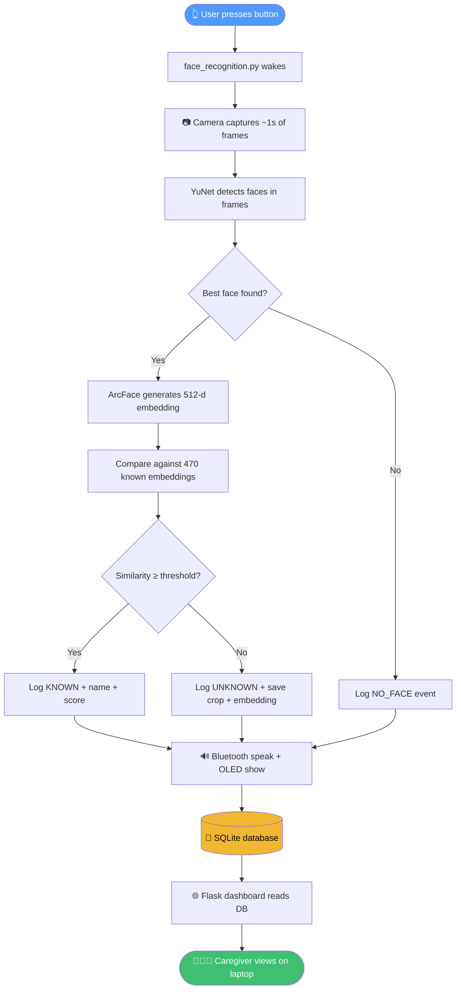

# 🧠 Cognitive Assist — Offline Face Recognition with Local Dashboard

> A Raspberry Pi wearable that recognises faces entirely offline, speaks
> the result aloud, and logs every attempt to a local database that you
> can browse from any phone or laptop on the same WiFi.

**No cloud. No internet. No external API. Everything runs on the Pi.**

---

## ✨ What this project does

- 🔘 **Button press** starts one recognition attempt (not continuous).
- 🎥 **Camera captures** a short burst of frames and picks the best face.
- 🧬 **ArcFace** generates a 512-dimensional embedding and compares it against your pre-registered database (30 people, 470 embeddings).
- 🗣️ **Bluetooth earbuds** announce the result (known name or "I do not recognise this person").
- 🖥️ **OLED display** shows status + last result.
- 💾 **SQLite database** records every event — known, unknown, no-face, or error.
- 🌐 **Web dashboard** (optional, starts at boot) lets a caregiver review everything from a phone on the same WiFi.

---

## 🏗️ How it works (at a glance)




**Plain-text fallback (if your viewer does not render Mermaid):**


```
Button → Camera → YuNet → ArcFace → Compare → Log → Speak/OLED
                                                      │
                                                      ▼
                                                  SQLite DB
                                                      │
                                                      ▼
                                                  Dashboard ← Laptop
```


---

## 🚀 First-time setup (do this once)

### 1. Activate the environment


```
cd /home/pi/FaceRecognitionSystem2
source /home/pi/FaceRecognitionSystem/.venv/bin/activate
```


### 2. Install the one new dependency


```
pip install Flask==3.1.0
```


Everything else is already installed. Nothing else is reinstalled.

### 3. Initialise the database


```
python database_setup.py
python database_setup.py --resync-people
```


Expected output:


```
[SETUP] Database initialized: /home/pi/FaceRecognitionSystem2/database/recognition.db
[SETUP] Synced people: 30 new row(s) inserted.
```


Both commands are **safe to re-run** — they never delete existing data.

### 4. Enable both services at boot


```
sudo systemctl daemon-reload
sudo systemctl enable face-recognition
sudo systemctl enable face-dashboard
```


Expected: each prints `Created symlink ...` and finishes without errors.

### 5. Reboot to verify


```
sudo reboot
```


After \~90 seconds, from the Pi:


```
systemctl is-active face-recognition
systemctl is-active face-dashboard
```


Both must print `active`.

### 6. Open the dashboard from your laptop


```
http://<pi-ip>:5000
```


Find the Pi's IP:


```
hostname -I | awk '{print $1}'
```


Or run the helper:


```
./show_dashboard_url.sh
```


You'll be prompted for the username and password you set in the systemd override.

---

## 🖥️ Accessing the dashboard

There are **three** ways to reach the dashboard. Pick the one that matches your network setup.

### Option A — mDNS hostname (easiest on most home networks)

If your Pi's hostname is `project17`, then:


```
http://project17.local:5000
```


Works out of the box on:

| **Device**            | **Works?**                                       |
| :-------------------- | :----------------------------------------------- |
| iPhone / iPad / macOS | ✅ Always                                         |
| Linux (any distro)    | ✅ Always                                         |
| Android 12+ (Chrome)  | ✅ Usually                                        |
| Windows 10/11         | ⚠️ Needs Apple's *Bonjour Print Services* (free) |

### Option B — Direct IP (always works)


```
http://192.168.114.246:5000
```


(replace with whatever `hostname -I` shows on your Pi — the IP can change if DHCP reassigns it)

### Option C — Pi provides its own WiFi hotspot (fixed URL forever)

If you want a truly self-contained device that works anywhere (no router, no internet, no IP guessing), make the Pi broadcast its own WiFi:


```
sudo nmcli device wifi hotspot ifname wlan0 ssid CognitiveAssist password "choose-a-strong-one"
```


From then on, whenever the Pi is powered:

1. Join WiFi network **CognitiveAssist**
2. Open `http://10.42.0.1:5000`

The URL never changes. This is the recommended setup for a portable/wearable device. Stick a label on the enclosure:


```
WiFi: CognitiveAssist
Password: choose-a-strong-one
Dashboard: http://10.42.0.1:5000
```


---

## 🎛️ Common commands cheat sheet

| **Task**                        | **Command**                                                                                          |
| :------------------------------ | :--------------------------------------------------------------------------------------------------- |
| Check if recognition is running | `systemctl is-active face-recognition`                                                               |
| Check if dashboard is running   | `systemctl is-active face-dashboard`                                                                 |
| See live recognition logs       | `sudo journalctl -u face-recognition -f`                                                             |
| See live dashboard logs         | `sudo journalctl -u face-dashboard -f`                                                               |
| Restart recognition             | `sudo systemctl restart face-recognition`                                                            |
| Restart dashboard               | `sudo systemctl restart face-dashboard`                                                              |
| Find the dashboard URL          | `./show_dashboard_url.sh`                                                                            |
| Back up the database            | `./backup_database.sh`                                                                               |
| Back up DB + images             | `./backup_database.sh --with-files`                                                                  |
| Inspect recent events           | `sqlite3 database/recognition.db "SELECT * FROM recognition_events ORDER BY id DESC LIMIT 10;"`      |
| Count events by status          | `sqlite3 database/recognition.db "SELECT status, COUNT(*) FROM recognition_events GROUP BY status;"` |

Full details for every command are in `MANUAL.md`.

---

## 📁 What's on disk


```
FaceRecognitionSystem2/
│
├── 🔴 face_recognition.py          ← main service (button → recognition → log)
├── 🔴 config.py                    ← all paths and thresholds
├── 🔴 face_camera.py               ← camera + ArcFace setup
├── 🔴 face_database.py             ← loads embeddings + matching logic
├── 🔴 button_handler.py            ← GPIO with debounce + cooldown
├── 🔴 bluetooth_audio.py           ← BT connection + Piper TTS
├── 🔴 oled_display.py              ← SH1106 status display
├── 🟢 recognition_logger.py        ← NEW: writes events to SQLite
├── 🟢 database_setup.py            ← NEW: schema init + people sync
├── 🟢 run_dashboard.sh             ← NEW: foreground dashboard runner
├── 🟢 backup_database.sh           ← NEW: safe SQLite backup
├── 🟢 show_dashboard_url.sh        ← NEW: prints reachable URLs
├── 🟢 face-dashboard.service       ← NEW: systemd unit
│
├── 🌐 web_dashboard/
│   ├── __init__.py
│   ├── config.py                   ← paths (self-contained, no cv2 import)
│   ├── app.py                      ← Flask app + routes
│   ├── queries.py                  ← all SQL queries
│   ├── templates/                  ← 8 HTML templates
│   └── static/                     ← CSS + JS
│
├── 💾 database/
│   └── recognition.db              ← created at runtime (SQLite, WAL mode)
│
├── 🖼️ logs/unknown_faces/          ← saved crops of unknown faces (JPEG)
├── 🧬 unknown_embeddings/          ← saved embeddings of unknown faces (.npy)
├── 📦 backups/                     ← created by backup_database.sh
│
├── 🧪 tests/
│   ├── test_database.py
│   ├── test_logger.py
│   ├── test_integration.py
│   ├── test_web_app.py
│   └── test_cross_process.py
│
├── 📚 models/                      ← YuNet + ArcFace .onnx files
├── 📚 Embeddings/                  ← your registered faces (470 embeddings)
└── 📚 voices/                      ← Piper TTS model files

🟢 = added in this project    🔴 = original (mostly unchanged)
```


---

## ✅ Verify everything works (7-step test)

Run this once after setup:

1. **Reboot** — `sudo reboot`, wait 90 s
2. **Confirm services** — `systemctl is-active face-recognition face-dashboard` → both `active`
3. **Press button** in front of a known face → audio speaks the name
4. **Press button** in front of an unknown face → audio says "I do not recognise this person"
5. **Cover camera + press button** → "No face detected"
6. **Open dashboard** from laptop → all three events visible in `/history`
7. **Open** `/unknown` → the unknown face's thumbnail is there

If all seven pass, everything is working.

---

## 🔒 Security — read this

The dashboard displays **real biometric data**. By default it is protected by HTTP basic auth (username + password you set in the systemd override). If you did not set those env vars, **anyone on your WiFi can see the dashboard**.

Enable auth if not already done:


```
sudo systemctl edit face-dashboard
```


In the drop-in editor, add (above the "will be discarded" line):


```
[Service]
Environment="DASHBOARD_USER=caregiver"
Environment="DASHBOARD_PASSWORD=your-strong-password"
```


Save, then:


```
sudo systemctl daemon-reload
sudo systemctl restart face-dashboard
```


**Never** forward port 5000 from your router. This dashboard is for LAN-only use.

---

## 🆘 Quick troubleshooting

| **Problem**                                         | **Fix**                                                                                   |
| :-------------------------------------------------- | :---------------------------------------------------------------------------------------- |
| Dashboard shows "site can't be reached"             | `systemctl is-active face-dashboard`; try `show_dashboard_url.sh`                         |
| Browser asks for password forever                   | Password mismatch; re-check the env var in `systemctl show face-dashboard -p Environment` |
| Dashboard shows 0 events but recognition is logging | Dashboard is reading wrong DB; check `[DASHBOARD] Database:` in its log                   |
| Recognition service fails to start                  | `sudo journalctl -u face-recognition -n 50`                                               |
| Camera "cannot open"                                | Reseat the ribbon cable; `rpicam-hello --list-cameras`                                    |
| Timestamps are wrong                                | `timedatectl status` — enable NTP or set manually                                         |
| `sqlite3: command not found`                        | `sudo apt install -y sqlite3` (only needed for manual DB inspection)                      |

Full troubleshooting reference is in `MANUAL.md`.

---

## 📖 Where to go next

- **Day-to-day operations** → read [`MANUAL.md`](https://manual.md/)
- **Adding new people to the face database** → see MANUAL.md → "Adding a New Person"
- **Reviewing unknown faces** → open `/unknown` in the dashboard
- **Backing up** → `./backup_database.sh --with-files`
- **Tuning thresholds** → edit `THRESHOLD` in `config.py` (default 0.40) and restart recognition

---

## 📜 License / credits

- **YuNet** — face detection model (OpenCV)
- **ArcFace** (`w600k_r50.onnx`) — face embedding model (InsightFace)
- **Piper** — offline text-to-speech
- **Flask** — web dashboard framework

Built for a Raspberry Pi 4B (2 GB) running Debian 13 Trixie, Python 3.13.
